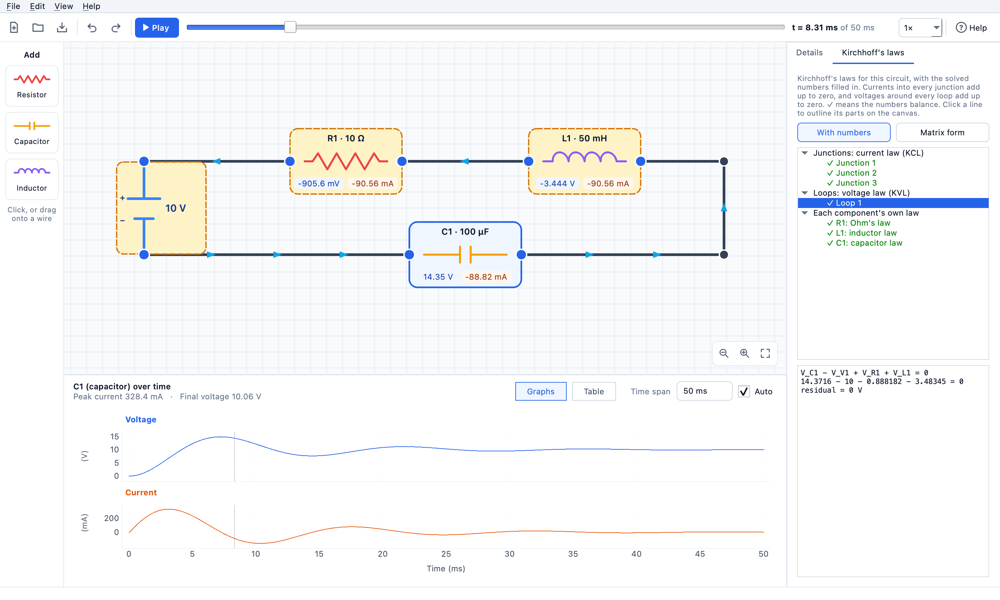

# CircuitCanvas

**A visual RLC circuit builder and time-domain simulator.** Start from a complete construction loop, insert resistors, capacitors, and inductors in series or parallel, and watch the Kirchhoff equations, current direction, voltage, power, and stored energy update automatically.



## Why this project exists

CircuitCanvas connects three subjects that are often taught separately:

- circuit theory and Kirchhoff's laws;
- differential equations and numerical integration; and
- interactive software engineering.

The application does not call an external circuit simulator. Its Python solver assembles a Modified Nodal Analysis system for the circuit and integrates the resulting linear descriptor equation over time.

## Highlights

- A ready-made battery loop that becomes a valid circuit as soon as a component replaces part of its wire
- Drop-on-wire series insertion plus automatically wired parallel duplication
- Explicit terminal wiring with junctions and non-connecting wire crossings
- Clean horizontal, vertical, or 45° wire routing—never arbitrary-angle segments
- Movable components, 90° rotation, route-constrained junctions, and editable wire bends
- Repeated addition of any practical number of R, C, and L components
- Engineering-style value entry (`4.7k`, `10u`, `4k7`, `2.2 MΩ`) and logarithmic sliders
- An automatic time span of about five time constants, so slow and fast circuits both show their whole response (or type your own span)
- Live voltage and current labels next to every component
- Animated blue arrows whose direction and speed follow solved wire current
- Complete KCL, independent KVL-loop, and element-law equations
- Ordinary numeric equations or the differential MNA/DAE system at any time sample
- Residual indicators that show whether each displayed Kirchhoff equation balances
- RC, RL, and RLC transient simulation after every edit
- Independent voltage and current axes with a shared time cursor
- Data table for time, voltage, current, power, and stored energy
- Circuit totals for source current, source power, and reactive energy
- Versioned JSON save/load plus CSV and PNG export, with an unsaved-changes prompt
- Undo/redo (a whole slider drag or voltage edit is one step) and revision-safe background calculation
- Specific diagnostics for open, floating, singular, and non-finite circuits
- Built-in examples, a quick start guide, a shortcut reference, and tooltips on every control and canvas item
- Analytical tests against closed-form RC and RL solutions

## Install and run

CircuitCanvas requires Python 3.12 or newer.

```bash
python3 -m venv .venv
source .venv/bin/activate
python -m pip install --upgrade pip
python -m pip install -e ".[dev]"
circuitcanvas
```

On Windows, activate the environment with `.venv\Scripts\activate` before running the remaining commands.

## Build a circuit

New here? Choose **Help ▸ Quick Start Guide** in the app, or **File ▸ Open Example** for a ready-made circuit.

1. The canvas opens with a battery, a complete construction loop, and a "Start here" card. The wire-only loop is intentionally marked as a short circuit until you insert a component.
2. Click **Resistor**, **Capacitor**, or **Inductor** to insert it **in series** on the longest wire, or drag it onto the exact wire you want. The palette stays visible while you edit.
3. Double-click a component (or select it) to edit it in the **Inspector**. Type values such as `4.7k`, `10u`, `4k7`, or `2.2 MΩ`, or drag the logarithmic slider. Double-click the battery to change its voltage.
4. Choose **Add parallel** to create a fully wired parallel branch, or drop a component on empty canvas and connect it manually.
5. Drag an orange terminal dot to another terminal to make a connection. Drop a new wire onto an existing wire to create a real electrical junction; a visual crossing without a junction dot remains disconnected.
6. Shift-drag a junction dot to continue wiring from it. Every segment snaps to horizontal, vertical, or 45°, while junctions and bend handles remain on their wire paths when dragged.
7. **Rotate** (or `R`) turns the selected component. **Delete**/**Backspace** removes whatever is selected: components, wires, junction dots, or bend handles.
8. Scroll (or two-finger swipe) to pan the canvas. Zoom with ⌘/Ctrl + scroll, a trackpad pinch, or ⌘/Ctrl `+`/`−`; **Fit view** (⌘/Ctrl `0`) shows the whole circuit again.
9. **Time span** is automatic by default: about five of the circuit's slowest time constants, so an RC with τ = 10 s is simulated for 50 s. Type a value such as `200 ms` to set it yourself.
10. Open **Equations** and switch between **Ordinary** and **Differential**. Selecting an equation outlines its circuit elements without changing the selection.
11. Press **Play** to animate time and the blue current arrows, or drag the time cursor to inspect one instant.
12. Use **Data table**, **Export CSV**, or **Export PNG** to keep the result. With nothing selected, Export CSV saves every component in one table.

Five ready-to-run circuits ship inside the package in [`src/circuitcanvas/examples/`](src/circuitcanvas/examples), including [`parallel-series-17v.json`](src/circuitcanvas/examples/parallel-series-17v.json), where a 200 Ω resistor is parallel with a 100 Ω + 100 Ω series branch.

## Mathematical model

The solver forms the Modified Nodal Analysis equation

\[
Gx(t)+C\dot{x}(t)=b(t),
\]

where the state contains non-ground node voltages and auxiliary currents for the ideal source and inductors. The battery is a step input at \(t=0\), capacitor voltage begins at zero, and inductor current begins at zero.

The default integrator is the implicit trapezoidal rule:

\[
\left(G+\frac{2C}{\Delta t}\right)x_{k+1}
=\left(\frac{2C}{\Delta t}-G\right)x_k+b_{k+1}+b_k.
\]

Backward Euler is also supported. Matrix factorizations are reused across fixed steps. See [the mathematical notes](docs/mathematics.md) for component stamps, sign conventions, and verification equations.

## Architecture

```text
PySide6 interaction
       ↓ atomic command
Circuit graph + revision
       ↓ immutable snapshot
Validation → MNA assembly → transient integration
       ↓ revision check
Canvas labels + plots + table + exports
```

The domain and solver packages have no Qt dependencies, which keeps the numerical core easy to test and reusable. Physical connectivity comes only from terminal-to-terminal wires and explicit junctions—not screen proximity. Background results carry the circuit revision that produced them, so a slow older simulation cannot overwrite a newer edit. See [the architecture notes](docs/architecture.md) for module boundaries and data flow.

## Verify the project

```bash
ruff format --check .
ruff check .
mypy src
QT_QPA_PLATFORM=offscreen python -m pytest -q
python -m build
```

The suite covers free graph edits, schema migration, MNA stamps, analytical transients, KCL/KVL residuals, ideal-wire flow reconstruction, GUI interaction, animation, stale background results, exports, and example circuits.

## Create the macOS application

```bash
pyinstaller --noconfirm circuitcanvas.spec
open "dist/CircuitCanvas.app"
```

The source remains Windows-compatible; a Windows executable can be built from the same spec on Windows.

## Current scope

Version 0.3 models one ideal DC source and arbitrary ideal-wire networks of linear R, C, and L components. It intentionally does not claim support for diodes, transistors, dependent or multiple sources, wire resistance, or frequency-domain analysis.

Current inside a zero-resistance wire loop is not physically unique. CircuitCanvas therefore displays the deterministic minimum-norm wire-flow solution that satisfies every terminal injection and KCL constraint; component currents and all electrical results still come directly from MNA.

The next mathematically coherent extension is a sinusoidal source with impedance, phasors, resonance sweeps, and Bode plots.

## License

Released under the [MIT License](LICENSE).
