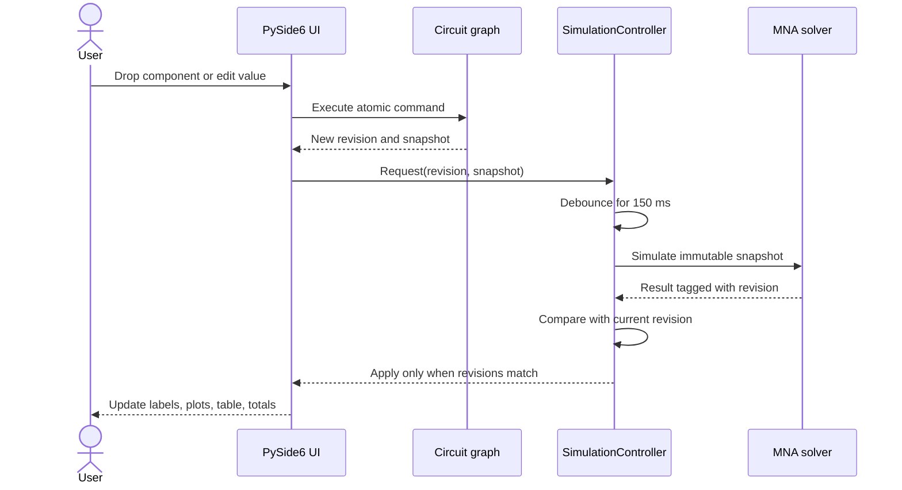

# CircuitCanvas Architecture

## Boundary map

CircuitCanvas separates the electrical model, solver, and user interface so each layer can be understood and tested independently.

| Package | Responsibility | Depends on Qt |
|---|---|---|
| `domain` | Components, nodes, settings, snapshots, JSON persistence | No |
| `commands` | Atomic series/parallel/value/delete edits and undo state | No |
| `solver` | Validation, MNA stamping, time integration, result derivation | No |
| `ui` | Canvas, dragging, inspection, plotting, export, background work | Yes |

The solver accepts `CircuitSnapshot`, an immutable representation of source, nodes, components, settings, and revision. It never reads coordinates from the graphics scene. The scene refers to components through stable IDs and never treats nearby pixels as electrical connectivity.

## Edit-to-result sequence

## Circuit construction

The public interaction model is deliberately narrower than the internal graph:

- an initial drop closes the battery loop;
- a series insertion splits a component edge with a new node;
- a parallel insertion reuses an existing component's endpoint nodes; and
- operations may be repeated without a fixed component count.

This produces useful series-parallel networks while avoiding ambiguous freehand connections. The canvas groups equal endpoint pairs vertically as parallel branches and lays distinct endpoint groups horizontally. Its scene rectangle expands in both directions for large networks.

## Background simulation

`SimulationController` owns a single-shot debounce timer and a `QThreadPool`. Every request replaces the pending snapshot and updates `current_revision`. A worker emits either a `SimulationResult` or a diagnostic. The controller forwards a result only if its revision still equals `current_revision`.

This prevents two common GUI errors:

1. slider movement starting hundreds of overlapping solves; and
2. a slower old solve overwriting values from a newer topology.

## Result model

`SimulationResult` owns aligned NumPy arrays for time, state, node voltage, source current/power, residual, and per-component branch data. `BranchResult` contains voltage, current, instantaneous power, and stored energy.

Arrays become read-only when the result is created. Presentation widgets therefore cannot accidentally mutate the numerical output shared by the canvas, plot, table, and exporter.

## Persistence

The JSON file contains a schema version, source, components, nodes, positions, simulation settings, and open-edge state. Computed arrays are not saved because they can be reproduced from the authoritative circuit.

Unsupported schema versions and malformed files raise `CircuitFileError` with an actionable message. Stable component IDs and layout coordinates survive a round trip.

