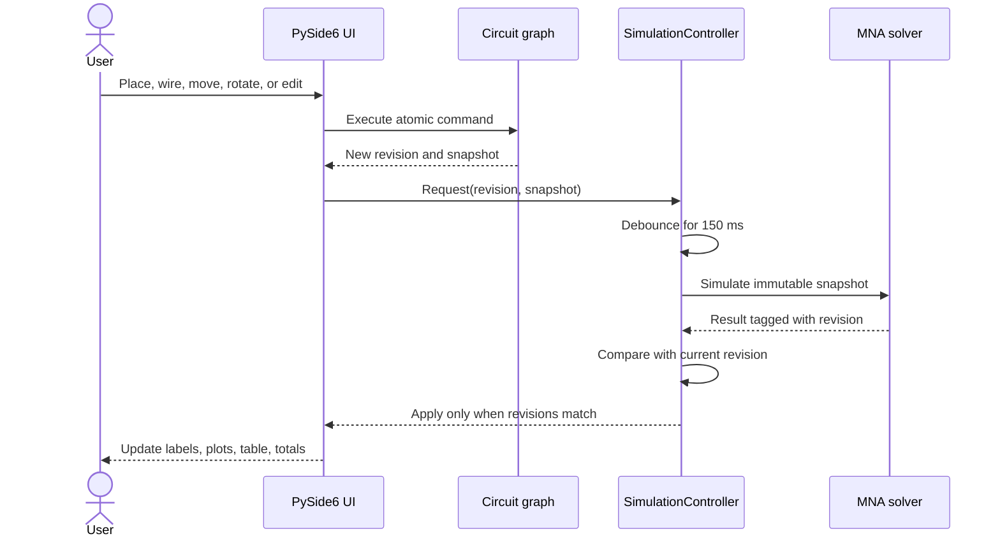

# CircuitCanvas Architecture

## Boundary map

CircuitCanvas separates the electrical model, solver, and user interface so each layer can be understood and tested independently.

| Package | Responsibility | Depends on Qt |
|---|---|---|
| `domain` | Components, terminal/junction wiring, settings, snapshots, JSON persistence | No |
| `commands` | Atomic topology/layout/value edits and complete undo state | No |
| `solver` | Validation, netlist derivation, MNA, equations, wire flow, integration | No |
| `ui` | Free canvas, equation browser, animation, plots, export, background work | Yes |

The solver accepts `CircuitSnapshot`, an immutable representation of source, nodes, components, settings, and revision. It never reads coordinates from the graphics scene. The scene refers to components through stable IDs and never treats nearby pixels as electrical connectivity.

## Edit-to-result sequence

## Physical wiring and electrical connectivity

Every component and the battery expose two stable terminal references. A wire joins two terminal or junction references and may carry any number of visual route points. The UI normalizes those routes so each displayed segment is horizontal, vertical, or exactly 45°. A union-find pass collapses each connected ideal-wire set into one solver node when an immutable snapshot is created.

This separation makes the rules unambiguous:

- moving a component or a bend changes only layout;
- crossing wire paths do not connect;
- dropping on a wire splits it with an explicit junction;
- dropping a component on a wire atomically replaces that span with a series element;
- parallel duplication atomically adds the component and both branch wires;
- dragged junctions and route handles are projected onto their existing wire path;
- multiple branches may share either terminal, so arbitrary series/parallel combinations are natural; and
- solver connectivity never depends on pixel distance.

All topology and layout edits are stored by `CircuitCommandStack`, so undo/redo restores components, rotations, junctions, routes, and counters together.

## Kirchhoff presentation layer

After MNA solves the immutable graph, the equation builder enumerates every non-ground KCL equation, a multigraph fundamental-cycle basis for independent KVL equations, and the R/C/L constitutive laws. Each row carries symbolic text, substituted values, a residual, and the involved IDs so the equation panel can highlight the canvas.

The differential view exposes the same circuit as `C x_dot(t) + G x(t) = b(t)` together with the exact unknown vector and matrices used by the numerical solver.

The wire-flow layer solves the ideal-conductor incidence system `Bf = -q` with a deterministic minimum-norm solution. This supplies KCL-consistent animation arrows without pretending that current distribution around a zero-resistance wire-only loop is uniquely measurable.

## Background simulation

`SimulationController` owns a single-shot debounce timer and a `QThreadPool`. Every request replaces the pending snapshot and updates `current_revision`. A worker emits either a `SimulationResult` or a diagnostic. The controller forwards a result only if its revision still equals `current_revision`.

This prevents two common GUI errors:

1. slider movement starting hundreds of overlapping solves; and
2. a slower old solve overwriting values from a newer topology.

## Result model

`SimulationResult` owns aligned NumPy arrays for time, state, node voltage, source current/power, residual, and per-component branch data. `BranchResult` contains voltage, current, instantaneous power, and stored energy.

Arrays become read-only when the result is created. Presentation widgets therefore cannot accidentally mutate the numerical output shared by the canvas, plot, table, and exporter.

## Persistence

Schema version 2 stores source, components, positions, rotations, terminal/junction endpoints, wire routes, and simulation settings. Schema-1 series/parallel files are migrated by synthesizing explicit junction wiring. Computed arrays are not saved because they can be reproduced from the authoritative circuit.

Unsupported schema versions and malformed files raise `CircuitFileError` with an actionable message. Stable component IDs and layout coordinates survive a round trip.
